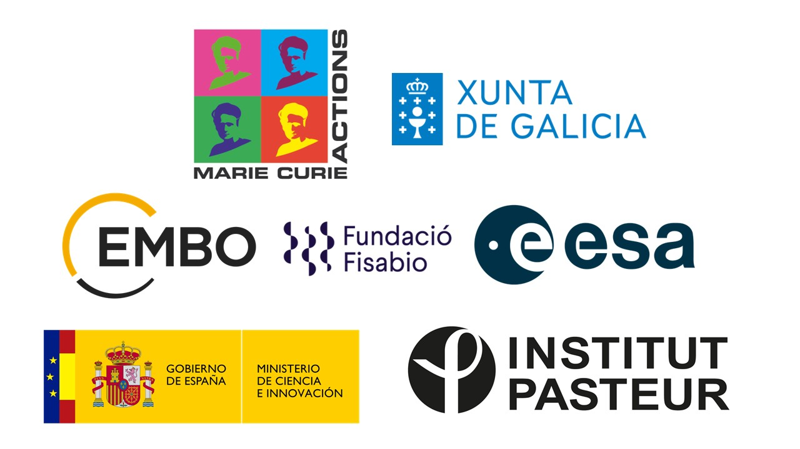

<!-- SECTION 1: MAJOR RESEARCH GRANTS & FELLOWSHIPS -->

  

    <h2>Research grants & postdoctoral fellowships</h2>
    Competitive funding
  

  <!-- ACTIVE: NANO4TALENT -->
  

    

      <h3 class="funding-title">MSCA-COFUND Nano4Talent Postdoctoral Fellowship</h3>
      

        Active
        168,000 €
        2026 – 2028
      

    

    
Nanomaterials to modulate viral infections

    

      <strong>Agency:</strong> Marie Skłodowska-Curie Actions (MSCA-COFUND) / Xunta de Galicia
      <strong>Host:</strong> CINBIO, Universidade de Vigo (Spain)
    

  

  <!-- PASTEUR SEED GRANT -->
  

    

      <h3 class="funding-title">Pasteur Seed Grant</h3>
      

        10,000 €
        2026
      

    

    
Enteric viral infections and systemic aging in <em>Drosophila melanogaster</em>

    

      <strong>Agency:</strong> Institut Pasteur
      <strong>Host:</strong> Institut Pasteur (France)
    

  

  <!-- PASTEUR-ROUX-CANTARINI -->
  

    

      <h3 class="funding-title">Pasteur-Roux-Cantarini Postdoctoral Fellowship</h3>
      

        2-year salary
        2024 – 2026
      

    

    
How host bacteriomes drive viral evolution and virulence

    

      <strong>Agency:</strong> Institut Pasteur
      <strong>Host:</strong> Institut Pasteur (France)
    

  

  <!-- EMBO POSTDOCTORAL FELLOWSHIP -->
  

    

      <h3 class="funding-title">EMBO Postdoctoral Fellowship</h3>
      

        143,000 €
        2021 – 2023
      

    

    
Microbiome impact on <em>Caenorhabditis elegans</em> viral infection and evolution of Orsay virus

    

      <strong>Agency:</strong> European Molecular Biology Organization (Ref. ALTF 311-2021)
      <strong>Host:</strong> IBENS, CNRS / ENS (France)
    

  

  <!-- ESA OSIP -->
  

    

      <h3 class="funding-title">European Space Agency (ESA) Research Grant</h3>
      

        180,682 €
        2021 – 2022
      

    

    
Dynamics of viral infection in simulated microgravity conditions

    

      <strong>Agency:</strong> European Space Agency (Open Space Innovation Platform)
      <strong>Role:</strong> Co-lead author (with Santiago F. Elena)
    

  

  <!-- FPI PREDOCTORAL -->
  

    

      <h3 class="funding-title">MINECO-FEDER FPI Predoctoral Fellowship</h3>
      

        92,750 €
        2017 – 2021
      

    

    
Virus adaptation at different biological and environmental levels

    

      <strong>Agency:</strong> Spanish Ministry of Science and Innovation (Ref. BES-2016-077078)
      <strong>Host:</strong> I2SysBio, CSIC – Universitat de València (Spain)
    

  

<!-- SECTION 2: MOBILITY, DISTINCTIONS & SHORT-TERM GRANTS -->

  

    <h2>Mobility grants, distinctions & awards</h2>
    Honors & short stays
  

  

    

      
2023

      
MSCA Seal of Excellence — Marie Skłodowska-Curie Actions Postdoctoral Fellowship

      
Distinction

    

    

      
2020

      
EMBO Short-Term Fellowship — Implementation of C. elegans as a model host at IBENS (Paris)

      
4,450 €

    

    

      
2020

      
FISABIO – Universitat de València Chair — European research stay grant

      
4,000 €

    

    

      
2020

      
GBE Best Student Paper Award (Honorable Mention) — Genome Biology and Evolution (published in 2019)

      
500 €

    

    

      
2020

      
AAAS / Science Program for Excellence in Science — Sponsored membership

      
Award

    

    

      
2020

      
Wellcome Genome Campus Conference Bursary — Travel grant

      
170 €

    

    

      
2015

      
MINECO-FEDER Department Collaboration Grant — University of Vigo (Ref. BOE-A-2015-700)

      
2,000 €

    

    

      
2014

      
European Commission & Xunta de Galicia ERASMUS+ Fellowships — University of Coimbra (Portugal)

      
2,800 €

    

  

  

Updated October 2026

