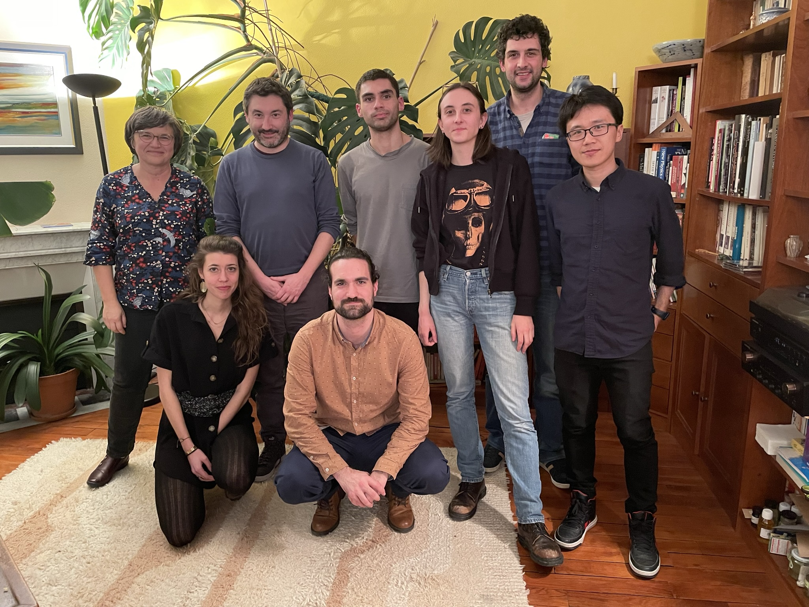
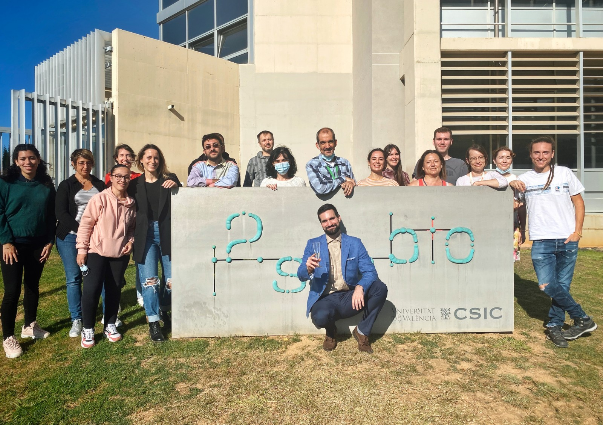

  

    My research investigates the fundamental principles governing <strong>viral infections and virus evolution</strong> across model systems. By integrating evolutionary biology, molecular virology, and systems approaches, my work uncovers how viruses evolve, impact host biology, and interact with environmental factors to shape infection outcomes.
  

  

    

      I completed my Ph.D. in Biotechnology under the supervision of <a href="https://sfelenalab.csic.es/sfelena/" target="_blank" rel="noopener">Santiago F. Elena</a> at the Institute for Integrative Systems Biology (I2SysBio, CSIC–UV), investigating the evolutionary dynamics and environmental drivers of plant viruses.
    

  

  

    

      Subsequently, as an <a href="https://www.embo.org/" target="_blank" rel="noopener">EMBO postdoctoral fellow</a> in the <a href="https://www.ibens.ens.fr/" target="_blank" rel="noopener">Marie-Anne Félix laboratory</a> at the École Normale Supérieure (IBENS, Paris), my research identified host genetic factors and natural bacterial environments that modulate susceptibility to viral infection in the nematode <em>Caenorhabditis elegans</em>.
    

  

  

    

      As a Pasteur-Roux-Cantarini postdoctoral researcher at the <a href="http://salehlab.eu" target="_blank" rel="noopener">Carla Saleh laboratory</a> (Institut Pasteur, Paris), I examined how enteric viral infections accelerate systemic aging in <em>Drosophila melanogaster</em>, explored microbiome-mediated viral pathogenesis, and studied the experimental evolution of diverse RNA viruses.
    

  

  

    

      Currently, I serve am a <a href="https://cinbio.es/en/nano4talent/about/" target="_blank" rel="noopener">Nano4Talent Research Fellow</a> (MSCA-COFUND) at the Center for Research in Nanomaterials and Biomedicine (<a href="https://cinbio.es/en" target="_blank" rel="noopener">CINBIO</a>) of the University of Vigo, expanding my research line on host-pathogen interactions and antiviral resilience through advanced systems biology and nanotechnological approaches.
    

  

  

    

      
    

    
Viruses and RNAi Unit (Carla Saleh Lab, Institut Pasteur, 2024)

  

  

    

      
    

    
Establishing C. elegans research facilities (2021)

  

  

    

      
    

    
Nematode host evolution (Marie-Anne Félix Lab, IBENS, 2023)

  

  

    

      
    

    
Evolutionary Systems Virology (Santiago F. Elena Lab, I2SysBio, 2021)

  

