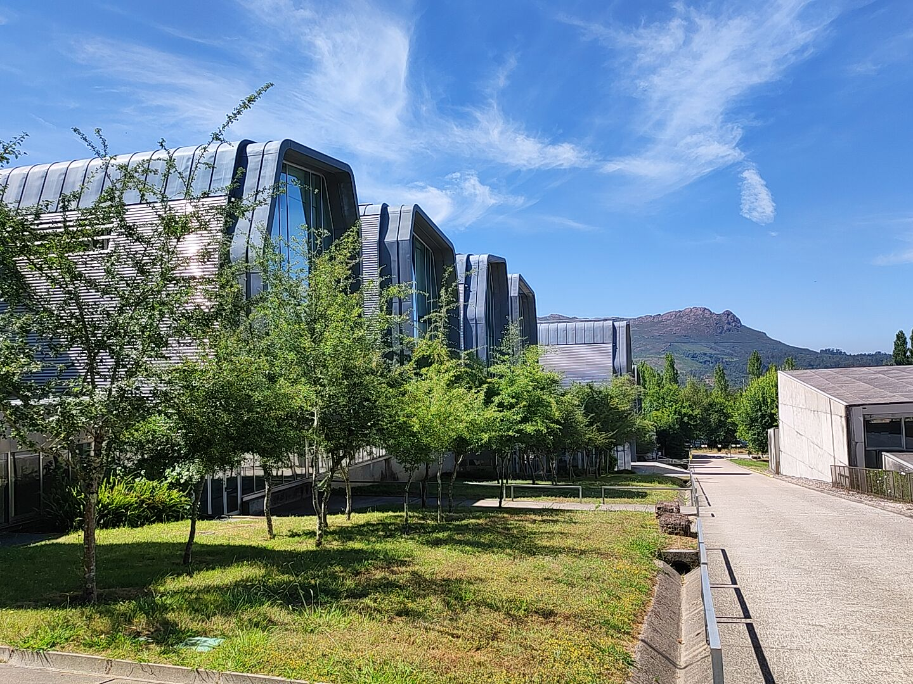

  

    I am always open to discussing new research questions, collaborative projects, and prospective opportunities across viral evolution, host–pathogen interactions, and the systems biology of infection.
  

  <!-- DIRECT CORRESPONDENCE -->
  

    
Electronic mail

    

      <a href="mailto:ru.gonzalez@uvigo.gal" class="email-link">ru.gonzalez@uvigo.gal</a>
      <button type="button" class="copy-email-btn" onclick="copyEmail(this)">Copy</button>
    

    

      For scientific inquiries, peer-review requests, or prospective student and postdoctoral opportunities.
    

  

  <!-- INSTITUTIONAL ADDRESS -->
  

    
Affiliation &amp; postal address

    

      <strong><a href="https://cinbio.es/en/" target="_blank" rel="noopener">Center for Research in Nanomaterials and Biomedicine (CINBIO)</a></strong> 
      Universidade de Vigo 
      Campus Universitario Lagoas-Marcosende 
      36310 Vigo, Spain
    

  

<figure class="campus-figure">
  
  <figcaption class="campus-caption">
    Center for Research in Nanomaterials and Biomedicine (CINBIO), Universidade de Vigo
    42°09′58″N 8°41′06″W
  </figcaption>
</figure>
